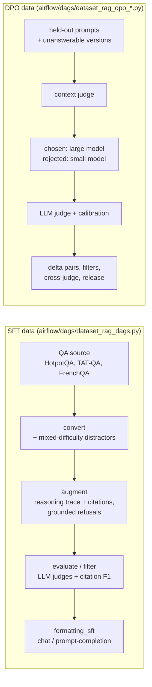

# dataset_rag

Data pipelines for faithful RAG post-training (paper in preparation: *Training Small Language Models for
Faithful Retrieval-Augmented Generation Using Semi-Synthetic Data and Preference Optimization*): semi-synthetic SFT data for grounded, cited answers and grounded refusals,
and judged preference pairs for DPO. Both pipelines are orchestrated with Apache Airflow; each task wraps a standalone
CLI script, so every step can also be run by hand.

> GRPO data and training will be added later.

## Overview



**SFT.** Questions from HotpotQA (EN/FR), TAT-QA and French extractive QA are placed among retrieved-looking
distractors (BM25 / dense, a hard–medium–random mix whose hard candidates are verified not to answer the question). An
LLM writes a reasoning trace and a cited answer with the same OpenRAG system prompt that is used at inference.
Unanswerable rows are clones of answerable rows with the gold evidence removed and replaced one-for-one by
distractors of the same kind, so that context length does not predict the label. The refusal explains, from the
documents, why the question cannot be answered. Rows are kept only if the factual judge gives 5/5, citations are
exact and, for refusals, the generator actually refused; an answerable row and its refusal clone are kept or dropped
together.

**DPO.** On held-out prompts, a large model (Qwen3.5-35B-A3B) and a small model (Qwen3.5-4B) answer the same
prompt. A reasoning judge (Qwen3.8-27B), calibrated against earlier verdicts, confirms the large-model answer (correct
and supported, citations valid, or a correct refusal) and identifies faults in the small-model answer (wrong answer,
unsupported reasoning, false refusal, invalid citation, hallucinated answer to an unanswerable question). Pairs are
built from confirmed chosen and faulty rejected answers, filtered, cross-judged by a model of another family
(Mistral) on refusals, and exported as train/val parquet configs.

## Layout

| Path | Content |
|---|---|
| `airflow/` | DAGs (`dags/`), Airflow CLI adapters of the DPO pipeline, `run_airflow.sh`, docs ([SFT](airflow/README.md), [DPO](airflow/DPO.md)) |
| `convert_*.py` | source datasets → pipeline format, distractor selection (`distractor_generation.py`) |
| `augment_hotpotqa.py`, `augment_tatqa.py` | LLM generation of reasoning traces, citations and grounded refusals |
| `evaluate_and_filter.py`, `evaluate_tatqa.py`, `evaluate_stream.py` | LLM judges, citation metrics, quality filter |
| `formatting_sft.py`, `benchmark_format.py`, `utils.py` | SFT formatting (shared OpenRAG prompt), common helpers |
| `dpo/` | DPO prompt building, sampling (`sample_policy.py`), judging, pair building, release |

Comments and log messages in the code are partly in French.

## Setup

Two Python environments: `venv` for the data pipelines (also used by the Airflow tasks, SFT and DPO), and `.venv`
for the standalone DPO launchers (`dpo/requirements.txt`, Python 3.13; set `DPO_VENV` to use another
path). They are separate because the pipeline pins `datasets<4`.

```bash
python3 -m venv venv
./venv/bin/pip install -r requirements.txt
python3.13 -m venv .venv
./.venv/bin/pip install -r dpo/requirements.txt
cp .env.example .env      # LLM endpoint (OpenAI-compatible) used for generation and judging
```

`.env` keys: `LLM_BASE_URL` (full `/v1/chat/completions` URL), `LLM_API_KEY`, `LLM_MODEL` (default generator /
judge). DPO scripts read the judge key from a file (`.judge_key`, `none` for a local vLLM without key) and take
endpoint URLs as arguments or through `LLM_API_URL` (base `/v1` URL). Shell scripts resolve paths relative to
`RAG_ROOT` (defaults to this directory). Models, generations and runs (`models/`, `runs/`, `dpo/data/`,
`airflow_runs/`) are not versioned.

Input data:

* HotpotQA: the HotpotQA DAGs read a `datasets` copy of `hotpotqa/hotpot_qa` (`distractor`, train) saved under
  `hotpotqa_cache_train/`; create it once with
  `python -c "from datasets import load_dataset; load_dataset('hotpotqa/hotpot_qa', 'distractor', split='train').save_to_disk('hotpotqa_cache_train')"`
  (`augment_hotpotqa.py` run without `--dataset` downloads and caches it under `hotpotqa_cache/` by itself);
* HotpotQA FR (translated): `dataset_rag_hotpotqa_fr` expects a machine-translated HotpotQA saved with `datasets`
  under `hotpotqa_french_cache_train.bak/`, not distributed here; point its `dataset_cache` parameter elsewhere or
  use the native `dataset_rag_hotpotqa_fr_abstracts`;
* TAT-QA: `tatqa_dataset_train.json` from the [official repository](https://github.com/NExTplusplus/TAT-QA) at the
  root of this directory;
* HotpotQA-fr abstracts: [`Mvanypersele/hotpotqa-fr-abstracts`](https://huggingface.co/datasets/Mvanypersele/hotpotqa-fr-abstracts);
* FrenchQA / PIAF: `CATIE-AQ/frenchQA`, downloaded by `convert_multilingual_qa.py`.

## Running

See [airflow/README.md](airflow/README.md) to install Airflow and trigger the SFT DAGs, and
[airflow/DPO.md](airflow/DPO.md) for the DPO DAGs (inference servers, judge, parameters). Example:

```bash
cd airflow
./run_airflow.sh db migrate
./run_airflow.sh pools set llm_api 2 "LLM API concurrency"
./run_airflow.sh standalone &
./run_airflow.sh dags trigger dataset_rag_tatqa --conf '{"run_name": "smoke", "limit": 100}'
```

Each task can also be run directly, e.g.

```bash
python augment_hotpotqa.py --language en --output out/hotpotqa_en_augmented --limit 100
python evaluate_and_filter.py --input out/hotpotqa_en_augmented.jsonl --output out/hotpotqa_en_evaluated.jsonl \
    --eval-chunks --llm-judge-factual --llm-judge-refusal --no-answer-match --filter
python formatting_sft.py --input out/hotpotqa_en_evaluated_filtered.jsonl --language en --format chat
```

## Datasets

* SFT: [`OpenLLM-France/Luciole_RAG`](https://huggingface.co/datasets/OpenLLM-France/Luciole_RAG)

## Benchmark exports

The pre-augmentation converters can also export a prompt-agnostic benchmark
schema:

```json
{
  "id": "...",
  "query": "...",
  "retrieved_documents": ["..."],
  "titles": ["..."],
  "supporting_index": [0],
  "answer": "..."
}
```

`supporting_index` contains zero-based indices into `retrieved_documents`.
An empty list means the query is unanswerable from the retrieved documents.

```bash
python3 convert_multilingual_qa.py --dataset piaf --language fr --output piaf_benchmark.jsonl --output-format benchmark
python3 convert_tatqa_to_augment_format.py --input tatqa.json --output tatqa_benchmark.jsonl --output-format benchmark
python3 convert_hotpotqa.py --split validation --output hotpotqa_val_benchmark.jsonl --output-format benchmark
```
