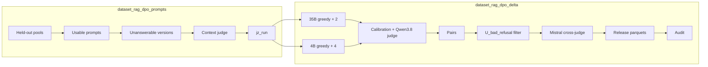

# DPO preference data: Delta pairs

Two DAGs build the DPO pairs of the paper: chosen = Qwen3.5-35B-A3B answer confirmed by a Qwen3.8-27B judge,
rejected = Qwen3.5-4B answer to the same prompt judged faulty, up to the released train/val parquet configs (no
upload).



## `dataset_rag_dpo_prompts`

| Task | Script | Role |
|---|---|---|
| `check_inputs` | none | inputs present, else explicit failure |
| `build_heldout_prompts` | `dpo/build_jz_prompts.py` | prompts of the held-out pools whose context verdict agrees with the label, excluding validation and paired-evaluation questions |
| `build_unanswerable_versions` | `dpo/build_unans_dag.py` | unanswerable versions built with the SFT pipeline code (one-for-one replacement of the removed gold chunks); missing TAT-QA `[CONTEXT]` summaries are generated |
| `judge_unanswerable_contexts` | `dpo/judge_pilot_contexts.py` | Qwen3.8-27B with reasoning checks that the versions are indeed unanswerable; failed calls are asked once more |
| `build_prompt_set` | `dpo/build_jz_run.py` | final prompt set: clones without padding dropped, versions judged unanswerable added, calibration set copied from `calib_from` when set |

Output: `airflow_runs/dataset_rag_dpo_prompts/<run_name>/jz_run`. With the `delta` parameter (a dict of
`dataset_rag_dpo_delta` parameters), the DAG then triggers `dataset_rag_dpo_delta` with `input_run` filled in;
without it, it stops at the prompt set, which can be reused by several generation runs.

Inputs (under `dataset_rag/`): the held-out pools `dpo/data/heldout_full_sft4152`,
`dpo/data/heldout_tatqa_generic_sft4152`, `dpo/data/heldout_tatqa_u_sft4152` (built by
`dpo/build_dpo_prompts_heldout.py`, `dpo/build_dpo_prompts_heldout_tatqa.py` and the `dpo/run_heldout_full.sh`,
`dpo/run_tatqa_heldout.sh`, `dpo/run_tatqa_u.sh` drivers from the rows not used for SFT), the exclusion lists
(`rag_dpo_onpolicy_8802410/val.jsonl`, `p9_paired_eval/prompts.jsonl`), `hotpotqa_cache_train`, the
`tatqa_converted.jsonl` and contextualisation cache of a `dataset_rag_tatqa` run, and, optionally, an existing `jz_run`
holding calibration verdicts (`calib_from`).

## `dataset_rag_dpo_delta`

| Task | Role |
|---|---|
| `prepare_prompts` | freezes the prompts; rejects unpadded clones, contradictory verdicts, leaks towards validation |
| `generate_chosen_35b` / `generate_rejected_4b` | `dpo/sample_policy.py`, no reasoning, top_p 0.80, top_k 20, min_p 0, 2,048 tokens; 35B: greedy + 2 samples at T 0.7, 4B: greedy + 4 at T 1.0; writes `generation_<gen>.manifest.json` (served model, precision, `/v1/models`) |
| `calibrate_and_judge` | `dpo/judge_chain.sh`: optional calibration (`calibrate`, agreement ≥ 0.9 on `answer_correct`), 35B chosen, every 4B sample, all with reasoning |
| `build_delta_pairs` | `dpo/build_p10_delta.py --jz` → `pairs/` |
| `filter_u_bad_refusal` | `dpo/filter_jz_delta.py` → `pairs_v2/` (drops `U_bad_refusal` pairs with a single judged defect) |
| `crossjudge_mistral` | optional (`crossjudge`, default false): `dpo/crossjudge_mistral.py` on chosen refusals → `crossjudge/` (informative column `chosen_mistral_judge`, null when skipped; nothing removed) |
| `format_release_configs` | `dpo/publish_jz_full_offpolicy.py` → `release/`: 4,096-token rule (policy tokenizer), splits by question / table, released columns |
| `audit_lengths_and_format` | `dpo/check_pairs_static.py` on `pairs/` and `pairs_v2/` |

**Missing verdicts.** Some judgements never come back (reasoning beyond `judge_max_tokens`, or no verdict), always
the same ones since the judge is greedy: about 110 out of 63,000 in the paper run. After the chain, a second pass asks
again for the missing ones; the rest is tolerated up to `max_missing_share` (1 % per generator and dataset) and written
to `judge_missing.json`. Above that, the task fails.

**Parameters.**
* Three OpenAI-compatible endpoints reachable **from the worker** (35B, 4B, judge); the worker does not start vLLM.
  The judge must be served as `judge_model` (default `Qwen3.8-27B`).
* `tokenizer` (token counts of the export) and `policy_tokenizer` (local directory of the SFT policy tokenizer,
  required by `format_release_configs`).
* `split_reference_revision`: revision of a Hub dataset whose splits are respected (`null` = splits by hash only).
* With `crossjudge: true`: `LLM_API_KEY` (environment or `.env`) and `mistral_url` for the Mistral cross-judge;
  `mistral_concurrency` ≤ 12.
  `.judge_key` for the judge (`none` for a vLLM without key).
* `tatqa_dataset_train.json` in `dataset_rag/` (TAT-QA leak check).

**Throughput.** About 57,000 reasoning judgements for 9,000 prompts: use a dedicated vLLM judge and raise
`judge_concurrency`. Each side (35B, 4B) gets 3/4 of `judge_concurrency`, so that a side left alone keeps the server
nearly full.

**Strict instruction.** Both DAGs only produce prompts with the generic instruction. The strict-instruction complement
(imposed refusal sentence) was built by hand: `dpo/build_jz_strict_prompts.py --quota hotpotqa:A=500,U=300 --quota
tatqa:A=500,U=650`, same generation and judging, then `dpo/build_p10_delta.py --jz` and `dpo/phrase_balance.py` to cap
the "sentence in chosen" pairs; merging them into the
published configs was a one-off step (release of 2026-10-08).

## Launching

All in one (prompts, then generation):

```bash
./run_airflow.sh dags trigger dataset_rag_dpo_prompts --conf '{"run_name": "p1", "delta": {
  "limit_questions": 20,
  "chosen_url": "http://gpu:8000/v1", "rejected_url": "http://gpu:8001/v1", "judge_url": "http://gpu:8002/v1",
  "tokenizer": "/path/Qwen3.5-4B", "policy_tokenizer": "/path/sft_policy"}}'
```

New generation run on existing prompts:

```bash
./run_airflow.sh dags trigger dataset_rag_dpo_delta --conf '{"run_name": "p1_seed2", "seed": 2,
  "input_run": "airflow_runs/dataset_rag_dpo_prompts/p1/jz_run", "chosen_url": "...", "rejected_url": "...",
  "judge_url": "...", "tokenizer": "...", "policy_tokenizer": "..."}'
```

Same `run_name` and same configuration = resume; changed configuration or prompts = new name. API tasks share the
`llm_api` pool; one active run per DAG.

## Outputs of `dataset_rag_dpo_delta`

In `airflow_runs/dataset_rag_dpo_delta/<run_name>/`: prompts, samples, verdicts, logs, `config.json`,
`inputs.manifest.json`, `judge_missing.json`, then `pairs/` (all pairs, TRL format and datatrove format), `pairs_v2/`
(after the filter), `crossjudge/judged.jsonl`, `release/<config>/{train,val}.parquet` and
`release/manifest_full_offpolicy_qwen35_35b_a3b.json`. Upload to the Hub and training are manual.
