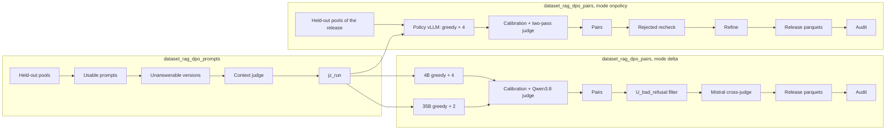

# DPO preference data: Delta and on-policy pairs

Two DAGs. `dataset_rag_dpo_prompts` builds the prompt set (`jz_run`); `dataset_rag_dpo_pairs` generates, judges and
builds the pairs according to `mode`:

* `delta`: chosen = Qwen3.5-35B-A3B answer confirmed by a Qwen3.8-27B judge, rejected = Qwen3.5-4B answer to the same
  prompt judged faulty (the `*_full_offpolicy_qwen35_35b_a3b` configs of `OpenLLM-France/RAG_DPO_onpolicy`);
* `onpolicy`: chosen and rejected both sampled from the SFT policy, served by a vLLM that the DAG starts itself on a
  GPU host (the `hotpotqa` / `tatqa` configs of the same repository).

Both modes stop at the released train/val parquet configs (with the `gold_answer` / `gold_scale` columns); upload and
training are manual.



## `dataset_rag_dpo_prompts`

| Task | Script | Role |
|---|---|---|
| `check_inputs` | none | inputs present, else explicit failure |
| `build_heldout_prompts` | `dpo/build_jz_prompts.py` | prompts of the held-out pools whose context verdict agrees with the label, excluding validation and paired-evaluation questions |
| `build_unanswerable_versions` | `dpo/build_unans_dag.py` | unanswerable versions built with the SFT pipeline code (one-for-one replacement of the removed gold chunks); missing TAT-QA `[CONTEXT]` summaries are generated |
| `judge_unanswerable_contexts` | `dpo/judge_pilot_contexts.py` | Qwen3.8-27B with reasoning checks that the versions are indeed unanswerable; failed calls are asked once more |
| `build_prompt_set` | `dpo/build_jz_run.py` | final prompt set: clones without padding dropped, versions judged unanswerable added, calibration set copied from `calib_from` when set |

Output: `airflow_runs/dataset_rag_dpo_prompts/<run_name>/jz_run`. With the `pairs` parameter (a dict of
`dataset_rag_dpo_pairs` parameters, `mode` included), the DAG then triggers `dataset_rag_dpo_pairs` with `input_run`
filled in; without it, it stops at the prompt set, which can be reused by several generation runs, delta or on-policy.

Inputs (under `dataset_rag/`): the held-out pools `dpo/data/heldout_full_sft4152`,
`dpo/data/heldout_tatqa_generic_sft4152`, `dpo/data/heldout_tatqa_u_sft4152` (built by
`dpo/build_dpo_prompts_heldout.py`, `dpo/build_dpo_prompts_heldout_tatqa.py` and the `dpo/run_heldout_full.sh`,
`dpo/run_tatqa_heldout.sh`, `dpo/run_tatqa_u.sh` drivers from the rows not used for SFT), the exclusion lists
(`rag_dpo_onpolicy_8802410/val.jsonl`, `p9_paired_eval/prompts.jsonl`), `hotpotqa_cache_train`, the
`tatqa_converted.jsonl` and contextualisation cache of a `dataset_rag_tatqa` run, and, optionally, an existing `jz_run`
holding calibration verdicts (`calib_from`).

### Source `sft_run`: the questions of an SFT run that stayed out of the SFT data

`"source": "sft_run"` replaces the held-out pools by a run of an SFT DAG of the HotpotQA family (`sft_run`:
`airflow_runs/<dag_id>/<run_name>`, e.g. `dataset_rag_hotpotqa_fr_abstracts/<run_name>`).

| Task | Role |
|---|---|
| `check_inputs` | `*_augmented_evaluated.jsonl` and its `_filtered`, calibration set of `calib_from` when set |
| `build_heldout_prompts` | `dpo/build_dpo_prompts_heldout.py extract` then `format`: every question none of whose versions reached the SFT data (answerable rows with factual judge 5; unanswerable versions the generator refused, with their answerable twin), put in the SFT format by `formatting_sft` (same language, citation format of the run, generic refusal rule only, without the invitation clause) |
| `build_unanswerable_versions` | nothing: the unanswerable versions come from the SFT DAG itself |
| `judge_unanswerable_contexts` | Qwen3.8-27B context judge (with reasoning) on **every** prompt of the pool |
| `build_prompt_set` | prompts whose verdict agrees with the label (an unanswerable version keeps its twin) → `jz_run/<generator>/<sft_dataset>/`, calibration set copied from `calib_from` when set |

Parameters: `sft_run`, `sft_dataset` (dataset name in the `jz_run`, default `hotpotqa_fr`, distinct from `hotpotqa` /
`tatqa`), `sft_language` (`fr` or `en`), `seed`. `dataset_rag_dpo_pairs` takes these prompts in delta mode only
(`pairs` with another mode is refused): every stage reads the datasets of the run (`dpo_common.delta_datasets`), the
dataset of the pairs and of the config `<sft_dataset>_full_offpolicy_qwen35_35b_a3b` is `sft_dataset`. With the `ref`
format, a chosen answer must carry valid tags only (`qwen_chosen_all.citation_ok`: document numbers, inline excerpts
verbatim up to whitespace, as `eval_ref_invalid`; an excerpt cut by "..." passes when each fragment is verbatim,
in order), the release checks the inline
excerpts against the documents (`release_text.quotes_found`) and also strips the French document openings and
inviting sentences (`normalize`). Gold columns come from `<sft_run>/<sft_dataset>_converted.jsonl`, or the run’s unique
`*_augmented_evaluated.jsonl` when the SFT DAG reads a cache directly (original answer,
also for the unanswerable versions); the split units are those of HotpotQA (same question ids). The prompts only make
on-policy data for a policy whose SFT data has that format.

**`ref` citation format in the DPO metrics** (`dpo/dpo_common.py`): numbered documents, `[Source N]` blocks of the
OpenRAG layout or `[N] filename:` in ref prompts built before it (`context_titles`), `ref` style inline / end of completion (`requested_citation_style`), French context marker
(`context_block`), and `citation_metrics(..., system_prompt)`: cited titles from the numbers, `n_ref_tags` /
`n_ref_invalid` (number outside the documents, excerpt empty or not verbatim, tag of another format), as
`eval_ref_invalid` of the SFT filter.

## `dataset_rag_dpo_pairs`

`prepare_prompts` freezes the prompts (sha256 manifest; rejects unpadded clones, contradictory verdicts, leaks towards
validation), then the `mode` task sends the run down one of the two branches; the other is skipped.
`audit_lengths_and_format` (`dpo/check_pairs_static.py`) ends both.

### Mode `delta`

| Task | Role |
|---|---|
| `generate_chosen_35b` / `generate_rejected_4b` | `dpo/sample_policy.py`, no reasoning, top_p 0.80, top_k 20, min_p 0, 2,048 tokens; 35B: greedy + 2 samples at T 0.7, 4B: greedy + 4 at T 1.0; writes `generation_<gen>.manifest.json` (served model, precision, `/v1/models`) |
| `calibrate_and_judge` | `dpo/judge_chain.sh`: optional calibration (`calibrate`, agreement ≥ 0.9 on `answer_correct`), 35B chosen, 4B samples a pair can use (below), all with reasoning |
| `build_delta_pairs` | `dpo/build_p10_delta.py --jz` → `pairs/` |

**4B judge budget** (`NEEDED_ONLY=1`, `dpo/jz_todo_rejected.py --chosen-gen qwen35_35b_a3b`): the Jean Zay run judged
every usable 4B sample; on a shared endpoint this is the bulk of the judge time (hotpotqa_fr: ~34,000 reasoning verdicts,
~30 h). Only what `build_p10_delta.py` can use is judged: prompts with an accepted 35B chosen; samples with
non-conforming citations (category `A_bad_citation`, last in priority) only when no citation-conforming sample of the
prompt is faulty, one per round in the order the build picks the rejected (greedy, then closest length to the chosen),
until one qualifies. A last 4B pass runs once the 35B side has finished (chosen accepted in its second round). Same
pairs, unless the accepted chosen of a prompt changes between two rounds.
| `filter_u_bad_refusal` | `dpo/filter_jz_delta.py` → `pairs_v2/` (drops `U_bad_refusal` pairs with a single judged defect) |
| `crossjudge_mistral` | optional (`crossjudge`, default false): `dpo/crossjudge_mistral.py` on chosen refusals → `crossjudge/` (informative column `chosen_mistral_judge`, null when skipped; nothing removed) |
| `format_release_configs` | `dpo/publish_jz_full_offpolicy.py --gold-columns` → `release/`: 4,096-token rule (policy tokenizer), splits by question / table, released columns |

Each generator is either given (`chosen_url`, `rejected_url`, with `chosen_key_file` / `rejected_key_file` when the
server requires a key) or started by the DAG like the on-policy policy (`chosen_serve` / `rejected_serve`, the matching
URL then `null`): vLLM in Docker on a GPU host over SSH, see *Policy server* below, with the keys of
`dpo_pipeline.GENERATOR_SERVE_DEFAULTS` (`model_dir` required; an HF cache repository is mounted whole and
`model_subdir: snapshots/<revision>` is served with the model's own chat template). `stop_policy_server` removes these
containers too. The judge endpoint is always given.

**Missing verdicts.** Some judgements never come back (reasoning beyond `judge_max_tokens`, or no verdict), always
the same ones since the judge is greedy: about 110 out of 63,000 in the paper run. After the chain, a second pass asks
again for the missing ones; the rest is tolerated up to `max_missing_share` (1 % per generator and dataset) and written
to `judge_missing.json`. Above that, the task fails. Same rule in on-policy mode.

### Mode `onpolicy`

| Task | Script | Role |
|---|---|---|
| `generate_policy` | `dpo/sample_policy.py` | starts the policy vLLM (see below), greedy + 4 samples at T 0.8, top_p 0.95, 1,024 tokens, seed 42; `sampling.manifest.json` per pool (sha256 of the weights, host, image); stops the server at the end |
| `stop_policy_server` | none | `trigger_rule=all_done`: removes the container even when the generation was killed; no-op in delta mode |
| `calibrate_and_judge_policy` | `dpo/score_pilot_samples.py`, `dpo/select_chosen_candidates.py`, `dpo/build_strict_pairs.py` | judge calibration (same set and threshold as delta); generic pools: pass 1 without reasoning on every sample, then the chosen candidates confirmed with reasoning (3 rounds, greedy first); strict pools: 4 rounds |
| `build_onpolicy_pairs` | `dpo/build_pilot_pairs.py`, `dpo/build_strict_pairs.py build --twin-dir` | pairs per pool → `pairs/` |
| `recheck_rejected` | `dpo/score_pilot_samples.py`, `dpo/audit_refusal_bodies.py` | every policy rejected judged again with reasoning (except the imposed sentence alone in strict pools); informative audit of the chosen refusal bodies of the generic pools (`u_chosen_bodies.jsonl`, nothing removed) |
| `refine_pairs` | `dpo/refine_pairs.py` | drops the rejected that the reasoning judge accepts, the unanswerable pairs whose rejected answer it finds supported (`--drop-u-supported`), the reviewed pids (`--u-review`, `--exclude-pids`) → `pairs_audited/` |
| `format_onpolicy_configs` | `dpo/prepare_onpolicy_publication.py --sources … --gold-columns` | release corrections, 4,096-token rule, TAT-QA split by table, released columns → `release/{hotpotqa,tatqa}/` |

**Prompts (`prompt_source`).**

* `jz_run` (default): `input_run`, the output of `dataset_rag_dpo_prompts`. Two generic-instruction pools
  (`hotpotqa_generic`, `tatqa_generic`); unanswerable prompts are the DAG versions. All HotpotQA questions of a
  `jz_run` are in the train pool, so the validation split is drawn as ~10 % of the questions by hash
  (`--hotpotqa-split qid`).
* `heldout_v2`: the four pools of the released configs (`hotpotqa_generic`, `hotpotqa_strict`, `tatqa_generic`,
  `tatqa_strict`) in `heldout_v2_dir` (`dpo/data/onpolicy_v2_sources`). A new run keeps the manual reviews that bear on
  the prompt (excluded pids, context judged answerable) and redoes the rest.
* `replay: true` (with `heldout_v2`): reuses the released samples and verdicts, no LLM call, no server;
  `format_onpolicy_configs` fails if the parquets differ from the release (sha256 of the `hotpotqa` / `tatqa` configs).

The replay gives back the `hotpotqa` / `tatqa` parquets of the release byte for byte, and the delta release rebuilt
from the paper pairs gives back the `*_full_offpolicy_qwen35_35b_a3b` configs.

#### Policy server

By default (`policy_url: null`), `generate_policy` serves the policy on `policy_serve.ssh_host`:

1. one multiplexed SSH connection (ControlMaster) for the whole task, with a local forward to the vLLM port (one
   connection per command gets the worker banned by fail2ban on jump hosts);
2. checks on the host: weights present, `MemAvailable` ≥ `min_free_gb` (else failure: the host is busy; the page cache
   is never dropped), running containers logged;
3. `docker run` of the vLLM image, port published on the host's `127.0.0.1` only, container
   `vllm_dpo_pairs_<run_name>`, and the thermal pauser if present;
4. wait for `/v1/models`, sample, then stop the container and the pauser and close the connection. An Airflow SIGTERM
   goes through these steps; `stop_policy_server` catches a hard kill.

`policy_serve` (missing keys = defaults of `dpo_pipeline.SERVE_DEFAULTS`):

| Key | Default | Role |
|---|---|---|
| `ssh_host` | `dgx` | SSH alias (or `user@host`) of the GPU host |
| `ssh_config` | `null` | SSH config file (null: the worker's `~/.ssh/config`); copied privately (mode 600) for each task |
| `model_dir` | `lora_instruct_ablation/models/sft_newrag_step4152` | policy weights on the host, relative to its `$HOME` |
| `image` | `nvcr.io/nvidia/vllm:26.02-py3` | vLLM image present on the host |
| `remote_port` | 8016 | vLLM port on the host |
| `max_model_len` / `gpu_memory_utilization` | 8192 / 0.30 | |
| `min_free_gb` | 50 | minimum available memory on the host |
| `thermal_pauser` | `null` | script on the host (relative to its `$HOME`) that freezes the container above 80 °C (null: none) |
| `startup_timeout` | 900 | seconds before giving up the start |

`policy_url` (with `policy_model`, the served name) bypasses all of this for an endpoint already served. When the
worker has no SSH setup of its own (containerised Airflow), give it a dedicated key and an `ssh_config` with
`IdentitiesOnly`, `IdentityFile` and `UserKnownHostsFile` as absolute paths it can read (and `ProxyJump` if the GPU
host sits behind jump hosts).

#### Known differences with the release (new run)

* stochastic sampling: a new run on the same prompts gives the same recipe, not the same pairs;
* `judge_max_tokens` (16,000 by default) applies to every reasoning judgement; the release used 6,000;
* every policy rejected is judged again; the first HotpotQA generic release had only rechecked a sample;
* with `jz_run`: generic instruction only, as in delta mode (no strict pools).

## Parameters

* Delta: OpenAI-compatible endpoints reachable **from the worker** for the judge and for each generator not started by
  the DAG (35B, 4B). The judge must be served as
  `judge_model` (default `Qwen3.8-27B`). `tokenizer` (token counts of the export).
* On-policy: the GPU host through `policy_serve` (or `policy_url`), and the judge endpoint.
* `policy_tokenizer`: local directory of the SFT policy tokenizer (required for the parquets).
* `split_reference_revision` (delta): revision of a Hub dataset whose splits are respected (`null` = splits by hash
  only).
* With `crossjudge: true`: `LLM_API_KEY` (environment or `.env`) and `mistral_url` for the Mistral cross-judge;
  `mistral_concurrency` ≤ 12.
  `.judge_key` for the judge (`none` for a vLLM without key);
  `chosen_key_file` / `rejected_key_file` (files under `dataset_rag/`) when the 35B / 4B servers require a key.
* In `dataset_rag/`: `tatqa_dataset_train.json` (TAT-QA leak check, gold columns) and `hotpotqa_cache_train` (gold
  columns); for on-policy also `tatqa_dataset_test_gold.json`, `tatqa_dev.json` and `hotpotqa_cache_validation`
  (checks of `prepare_onpolicy_publication.py`).

**Throughput.** About 57,000 reasoning judgements for 9,000 prompts in delta mode: use a dedicated vLLM judge and
raise `judge_concurrency`. Each side (35B, 4B) gets 3/4 of `judge_concurrency`, so that a side left alone keeps the
server nearly full. In on-policy mode, pass 1 has no reasoning (~45,000 short judgements for 9,000 prompts × 5
answers), then a few thousand with reasoning.

**Strict instruction (delta).** Both DAGs only produce prompts with the generic instruction. The strict-instruction
complement (imposed refusal sentence) was built by hand: `dpo/build_jz_strict_prompts.py --quota
hotpotqa:A=500,U=300 --quota tatqa:A=500,U=650`, same generation and judging, then `dpo/build_p10_delta.py --jz` and
`dpo/phrase_balance.py` to cap the "sentence in chosen" pairs; merging them into the
published configs was a one-off step (release of 2026-10-08). In on-policy
mode, the strict pools come from `heldout_v2`.

## Launching

All in one (prompts, then delta pairs):

```bash
./run_airflow.sh dags trigger dataset_rag_dpo_prompts --conf '{"run_name": "p1", "pairs": {
  "mode": "delta", "limit_questions": 20,
  "chosen_url": "http://gpu:8000/v1", "rejected_url": "http://gpu:8001/v1", "judge_url": "http://gpu:8002/v1",
  "tokenizer": "/path/Qwen3.5-4B", "policy_tokenizer": "/path/sft_policy"}}'
```

On-policy pairs on existing prompts, policy served on the GPU host:

```bash
./run_airflow.sh dags trigger dataset_rag_dpo_pairs --conf '{"run_name": "op1", "mode": "onpolicy",
  "input_run": "airflow_runs/dataset_rag_dpo_prompts/p1/jz_run",
  "policy_serve": {"ssh_host": "gpu"}, "judge_url": "http://judge:8000/v1",
  "policy_tokenizer": "/path/sft_policy"}'
```

Replay of the on-policy release (no LLM call):

```bash
./run_airflow.sh dags trigger dataset_rag_dpo_pairs --conf '{"run_name": "replay_v2", "mode": "onpolicy",
  "prompt_source": "heldout_v2", "replay": true, "policy_tokenizer": "/path/sft_policy"}'
```

Prompts from an SFT run:

```bash
./run_airflow.sh dags trigger dataset_rag_dpo_prompts --conf '{"run_name": "fr1", "source": "sft_run",
  "sft_run": "airflow_runs/dataset_rag_hotpotqa_fr_abstracts/<run_name>", "sft_dataset": "hotpotqa_fr",
  "sft_language": "fr", "judge_url": "http://judge:8000/v1"}'
```

Same `run_name` and same configuration = resume; changed configuration or prompts = new name. One active run per
DAG. In `dataset_rag_dpo_pairs`, only `crossjudge_mistral` takes a slot of the `llm_api` pool (the Mistral budget);
generators, policy server and Qwen judge are bounded by `generation_concurrency` / `judge_concurrency`.

## Outputs of `dataset_rag_dpo_pairs`

In `airflow_runs/dataset_rag_dpo_pairs/<run_name>/`: `config.json`, `inputs.manifest.json`, `judge_missing.json`, then

* delta: `<generator>/<dataset>/` (prompts, samples, verdicts), `pairs/` (all pairs, TRL format and datatrove format),
  `pairs_v2/` (after the filter), `crossjudge/judged.jsonl`, `release/<config>/{train,val}.parquet` and
  `release/manifest_full_offpolicy_qwen35_35b_a3b.json`;
* on-policy: `policy/<pool>/` (prompts, `samples.jsonl`, `sampling.manifest.json`, `scored.jsonl`, `verified.jsonl`,
  `rejected_think.jsonl`, `u_chosen_bodies.jsonl`, `pairs/`, `pairs_audited/`), `recheck_missing.json`,
  `release_sources.json`, `release/{hotpotqa,tatqa}/{train,val}.parquet`, `release/manifest.json`.
